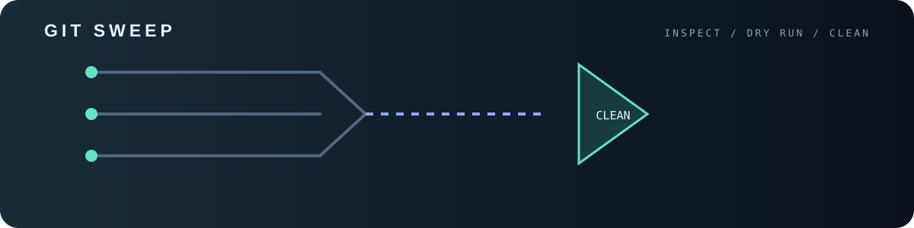

<p align="center">

<p align="center"></p>
  
</p>

<p align="center">
  
  
  
  
</p>

After a few months, `git branch` turns into a graveyard of `feature/...`, `fix/...` and `wip` branches that were merged long ago.
`git-sweep` finds them and removes them - **but only when you tell it to**. Every run is a dry run until you pass `--delete`.

## Features

- Detects branches that are **merged** into your base branch
- Detects branches whose **upstream is gone** (deleted on the remote after a squash/rebase merge)
- Optionally flags **stale** branches idle for N days (`--older-than`)
- **Dry run by default**, confirmation prompt before deleting
- Unmerged work is never removed unless you add `--force`
- Never touches the current branch, branches checked out in other worktrees, or protected names (`main`, `master`, `develop`, `dev`, `trunk`, `release`, `staging`, `production` + your own)
- Single file, standard library only

## Install

```bash
pip install git+https://github.com/ERROR404DTIR/git-sweep.git
```

Because the command is called `git-sweep`, git picks it up as a subcommand: `git sweep`.

No pip? Download the single file and run it:

```bash
curl -O https://raw.githubusercontent.com/ERROR404DTIR/git-sweep/main/git_sweep.py
python3 git_sweep.py
```

## Usage

```text
$ git sweep --fetch
Base branch: main

  feature/login-form                   merged                   12d
  fix/typo-readme                      merged                    3d
  chore/deps-bump                      upstream gone            41d  (not merged - needs --force)

Dry run: 2 branch(es) would be deleted. Re-run with --delete to apply.

$ git sweep --delete
Delete 2 branch(es)? [y/N] y
 deleted feature/login-form
 deleted fix/typo-readme
```

| Command | What it does |
| --- | --- |
| `git sweep` | Show what would be removed (dry run) |
| `git sweep --fetch` | `git fetch --prune` first, so "upstream gone" is accurate |
| `git sweep --delete` | Delete merged branches (asks first) |
| `git sweep --delete -y` | Delete without the prompt |
| `git sweep --older-than 60` | Also list unmerged branches idle for 60+ days |
| `git sweep --delete --force` | Also delete unmerged candidates (gone/stale) |
| `git sweep --protect release/2.x` | Never touch this branch (repeatable) |
| `git sweep --base develop` | Compare against `develop` instead of main/master |

## How it decides

1. **Base branch**: `--base`, else `origin/HEAD`, else `main`, else `master`.
2. **Merged**: `git branch --merged <base>`.
3. **Upstream gone**: the branch tracked a remote branch that no longer exists.
4. **Stale**: last commit older than `--older-than` days (unmerged branches only).
5. Merged branches are safe to delete. Everything else is listed as *not merged* and skipped unless `--force`.

> Tip: squash-merged branches do not show up as "merged" in git. If your remote deletes branches after merge, `--fetch` plus the *upstream gone* check catches them.

## Exit codes

| Code | Meaning |
| --- | --- |
| `0` | Success (including "nothing to sweep") |
| `1` | Aborted at the prompt, or a deletion failed |
| `2` | Not a git repo, no base branch found, or non-interactive without `-y` |

## License

MIT